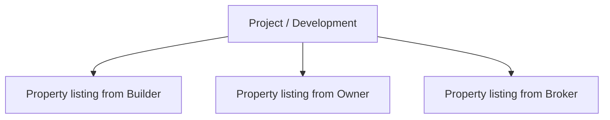
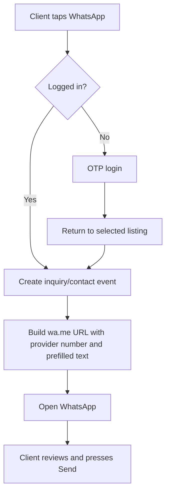
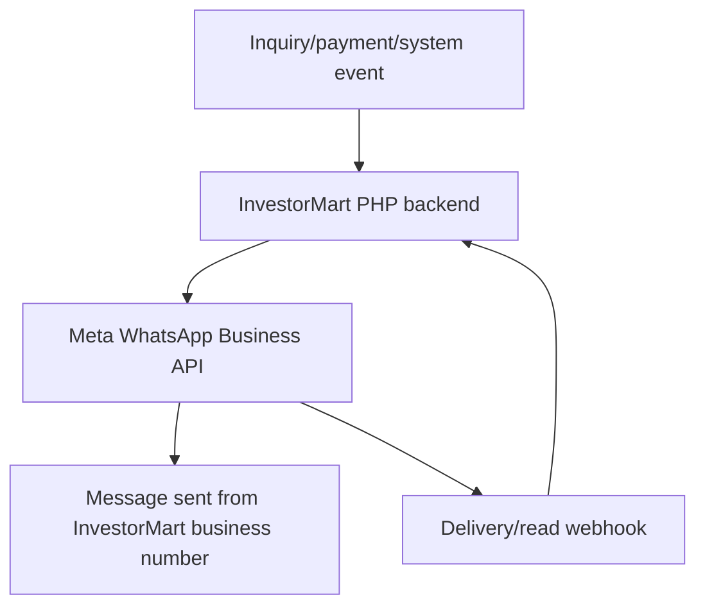
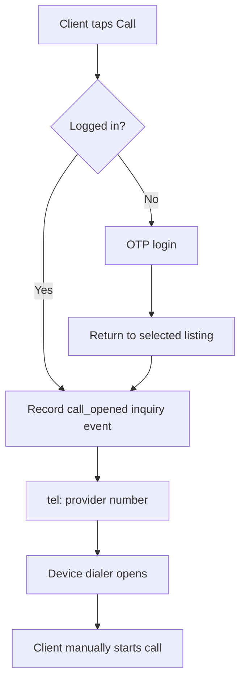
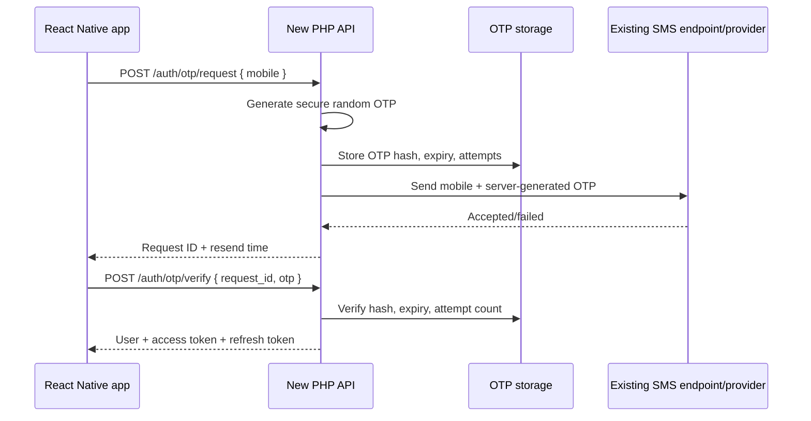
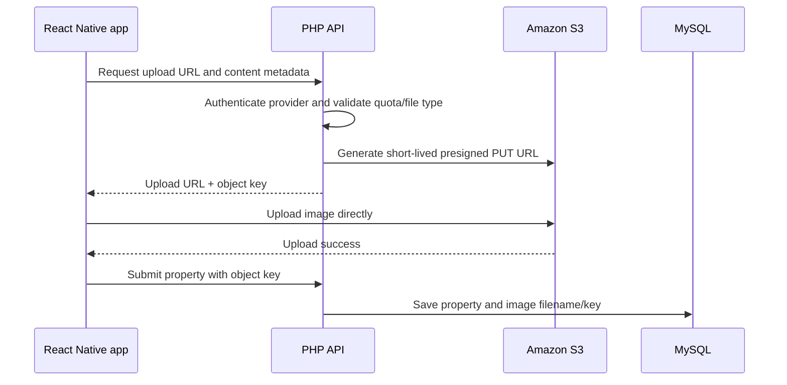

# InvestorMart Mobile App - Client Requirements and Integration Questionnaire

This document lists the business decisions, technical information, credentials, access, and deployment details required from the InvestorMart team before mobile app and PHP API development begins.

It is written for the existing InvestorMart website, database, admin panel, AWS storage, OTP service, Android app, and iOS app.

## 1. Decisions already confirmed

The following requirements are already agreed and do not need to be answered again.

### User experiences

The application has two main experiences:

1. Client
2. Property provider

A property provider has one of three subtypes:

- Builder
- Owner
- Broker

Builder, owner, and broker have the same interface, permissions, dashboard, property submission process, inquiry management, and paid-plan functionality. The subtype is stored only for identification and display.

### Guest browsing

- The login page will have a blurred **Skip** button in the upper-right corner.
- A guest opens the client dashboard.
- A guest can browse, search, filter, and view property/project details.
- Login is required to shortlist, call, open WhatsApp, or submit an inquiry.
- After login, the app returns the user to the property and resumes the intended action.

### Provider listing capacity

- Every builder, owner, and broker receives 10 free listing slots.
- All paid plans are one-time purchases valid for one month; none renew automatically.
- The plan number is a bonus added to the 10 free slots.
- The supplied database defines these paid plans:

| Plan | One-month price | Bonus slots | Total active capacity |
|---|---:|---:|---:|
| Premium 20 | ₹500 | 20 | 30 |
| Premium 50 | ₹1,000 | 50 | 60 |
| Premium 100 | ₹2,000 | 100 | 110 |
| Premium 200 | ₹3,500 | 200 | 210 |

- When the month ends, the provider returns to 10 active slots.
- The first 10 approved/live listings remain active by default, ordered by their first-publication time.
- Additional listings move to `plan_hold`: they remain visible and manageable in the provider workspace but disappear from all client/public catalogue results.
- The provider can choose which properties use the available slots. To activate a held property while all slots are occupied, the provider first pauses another live property or uses a server-supported swap action.
- When another paid plan is purchased, properties held only because of plan capacity automatically return to live status, in their previous publication priority, up to the new capacity.
- A property manually paused or archived by the provider does not reactivate automatically after a plan purchase.
- `plan_hold`, manual pause, archive, pending approval, and rejection are separate states with different meanings.
- Listing limits must be enforced by the PHP backend.
- The mobile interface only displays the totals returned by the backend.

### Backend and admin responsibility

- The new PHP API will use the existing website database.
- The delivery includes admin API endpoints and documentation.
- InvestorMart's employee will connect those endpoints to the existing admin-panel interface.
- Changes to the existing admin-panel UI are outside the mobile/backend delivery.

### Communication

- There is no in-app chat.
- There is no SMS conversation feature.
- The Call button opens the device dialer with the provider's number.
- The WhatsApp button opens a direct client-to-provider WhatsApp conversation with a prefilled message.
- The initial release does not require Meta WhatsApp Business API integration.

### Shortlist

- Shortlisting requires an authenticated client.
- The supplied database dump does not contain a shortlist, favorite, wishlist, or bookmark table.
- A new app shortlist table is required.

## 2. Project and property records

The database contains two different real-estate record types. They should not be treated as identical records.

### Project record

A record in the `project` table represents an entire real-estate development or community.

Examples of project-level information include:

- Project name
- Developer/builder
- City and locality
- RERA information
- Starting price range
- Available configurations
- Total towers and units
- Completion/possession date
- Project overview
- Site plan and location plan
- Floor plans
- Brochure
- Project gallery
- Project-level amenities
- Builder information

Conceptual example:

```text
Project: ABC Green Residency
Developer: ABC Developers
Location: Sector 150, Noida
Configurations: 2/3/4 BHK
Total towers: 8
Total units: 600
```

The supplied dump contains approximately 4,042 project records.

### Property record

A record in the `property` table represents one individual sale or rental listing submitted by a builder, owner, or broker.

Examples of property-level information include:

- For sale or rent
- Provider/user ID
- Exact price or rent
- Unit size
- BHK and bathrooms
- Floor number
- Furnishing
- Unit-specific images
- Contact number
- Approval status
- Listing expiry
- Boost status
- Parent project ID, when applicable

Conceptual example:

```text
Property: 3 BHK apartment for sale
Parent project: ABC Green Residency
Listed by: Broker
Unit size: 1,450 sq. ft.
Floor: 12
Price: INR 1.2 crore
```

The supplied dump contains 133 property records. Of these, 115 already contain a `project_id`, showing that one project can have multiple individual property listings.



### What the public website currently shows

The current website treats these as separate catalogue types:

- Projects search
- Buy search
- Rent search
- Top-Rated Projects section
- Recently Added Properties section

### Recommended mobile structure

The recommended app structure is:

- **Projects:** approved development/project pages from the `project` table.
- **Properties:** approved individual listings from the `property` table.
- A property page may show information from its parent project.
- A project page may show connected individual property listings.
- Unified search may return both, but every item must contain a `content_type` value of `project` or `property`.

Recommended endpoints:

```text
GET /api/v1/projects
GET /api/v1/projects/{id}
GET /api/v1/projects/{id}/properties

GET /api/v1/properties
GET /api/v1/properties/{id}

GET /api/v1/discover?content_type=all
```

## 3. Catalogue decision required from InvestorMart

InvestorMart must confirm one of these approaches:

### Option A - Projects and properties

- Show all approved projects.
- Show all approved individual properties.
- Keep separate project and property cards/screens.
- Connect property records to their parent project.

This is the recommended option because it matches the current website and database.

### Option B - Properties only

- Show only individual records from the `property` table.
- Do not expose the 4,042 project catalogue records in the initial app.

### Client question

> Should the mobile app include both the existing Project catalogue and individual Property listings, matching the website, or should the initial app show only individual Property records?

If both are required, InvestorMart should also confirm whether all 4,042 project records are ready for mobile display or whether only active/featured/current projects should be included.

## 4. Final communication flow

### Current selected flow: direct WhatsApp



Example link:

```text
https://wa.me/919876543210?text=<URL-encoded message>
```

Example prefilled message:

```text
Hello, I am interested in "3 BHK Apartment in Noida".
Property ID: 145
Please share more details.
```

No Meta API token is required for this flow. The client sends the message from their own WhatsApp account.

### Optional future flow: Meta WhatsApp Business API

Meta API is needed only if InvestorMart wants the platform's registered business number to send automated messages, such as:

- New inquiry notification to a provider
- Inquiry confirmation to a client
- Approved WhatsApp template
- Payment receipt or invoice-style message
- Automated follow-up
- Delivery/read webhook status



This is different from direct WhatsApp. Meta API sends from InvestorMart's business number, not from the client's personal WhatsApp account.

### Client question

> For the first release, please confirm that only direct client-to-provider WhatsApp is required. If InvestorMart also wants automated invoice, confirmation, or notification messages from its business number, please list each message type separately because that requires Meta WhatsApp Business API configuration and approved templates.

## 5. Call flow



The app can record that the dialer was opened. It cannot reliably claim that the call connected or was answered.

### Client questions

1. Should the dialer use the provider's `app_users.mobile_number` as the primary number?
2. Should a listing-specific contact number override the provider account number?
3. Should legacy project pages use `project.contact` when no provider account is attached?
4. Should every Call tap appear immediately as a new inquiry in both the provider dashboard and admin panel?

Recommended priority:

```text
Listing-specific verified number
    -> Provider account number
    -> Project contact number
    -> InvestorMart central contact number
```

## 6. OTP endpoint analysis

InvestorMart supplied a curl request for:

```text
POST https://www.investormart.co.in/sms/sendotpmessage
Content-Type: application/json
Cookie: ci_session=<redacted>

{
  "token": "<redacted>",
  "otp": "<server-generated OTP>",
  "mobileno": "<mobile number>"
}
```

### What can be determined

- This is an OTP SMS sending endpoint.
- `ci_session` strongly suggests that the website uses CodeIgniter or a CodeIgniter-compatible PHP session.
- The endpoint receives the OTP instead of generating it.
- The endpoint probably wraps an external SMS gateway.
- The `token` may be a static internal API token or SMS service authorization value.
- The curl request does not reveal whether the actual provider is MSG91, Twilio, 2Factor, Fast2SMS, AWS SNS, Textlocal, or another vendor.
- A session cookie is temporary and must not be hardcoded into the mobile application or backend configuration.

### Required OTP architecture

The React Native app must not call the legacy SMS endpoint directly and must not choose the OTP value.



### OTP questions for InvestorMart

1. Which SMS/OTP vendor is behind `/sms/sendotpmessage`?
2. Please provide the relevant PHP controller/service source code for this endpoint.
3. Is the supplied `token` permanent, environment-specific, or generated dynamically?
4. Is `ci_session` actually required, or was it copied automatically from Postman?
5. Can the endpoint be called server-to-server without an administrator/user session?
6. What success and error JSON responses does it return?
7. What SMS sender ID appears on the user's phone?
8. What is the approved OTP template text?
9. What are the DLT entity ID and DLT template ID?
10. What are the rate limits and costs?
11. Does the provider offer delivery-status callbacks/webhooks?
12. Are there staging/test credentials or approved test phone numbers?
13. What OTP length and expiry should the app use?
14. How many verification attempts and resend attempts are permitted?
15. Should the same endpoint support both registration and login?

### Credential handling

The token and session cookie supplied in the example should be treated as exposed. InvestorMart should rotate or invalidate them if they are active.

The final PHP environment may contain:

```env
OTP_PROVIDER=
OTP_SEND_URL=https://www.investormart.co.in/sms/sendotpmessage
OTP_SERVICE_TOKEN=
OTP_API_KEY=
OTP_SENDER_ID=
OTP_TEMPLATE_ID=
OTP_DLT_ENTITY_ID=
OTP_DLT_TEMPLATE_ID=
OTP_EXPIRY_SECONDS=300
OTP_RESEND_COOLDOWN_SECONDS=60
OTP_MAX_ATTEMPTS=5
```

No OTP provider secret will be placed in the React Native application.

## 7. AWS S3 findings and requirements

The public website currently serves images from an address matching:

```text
investormart.s3.ap-south-1.amazonaws.com
```

This suggests:

```text
Likely bucket: investormart
Likely region: ap-south-1
Current delivery: direct S3 URL
```

These values must be confirmed by InvestorMart. Public image URLs do not grant upload permission.

### Required image-upload flow



### Information required from InvestorMart

1. Confirm the S3 bucket name.
2. Confirm the AWS region.
3. Confirm whether project, property, builder, logo, floor-plan, brochure, and gallery files use different prefixes/folders.
4. Provide examples of the current S3 object-key conventions.
5. Confirm whether database fields store only filenames, relative keys, or full URLs.
6. Confirm whether new mobile uploads should be public or private.
7. Confirm whether CloudFront/CDN is used or planned.
8. Confirm maximum image count per property.
9. Confirm maximum image size and allowed formats.
10. Confirm whether the backend must resize/compress images or the app should compress before upload.
11. Confirm whether video upload is required or only an external video URL.
12. Confirm who deletes S3 objects when a property image is removed.
13. Confirm whether the deployment server is EC2, ECS, EKS, shared hosting, or another environment.
14. Confirm whether the deployment server already has an IAM role with access to the bucket.
15. Provide a test bucket or test prefix for staging uploads.

### Preferred AWS authentication

If the PHP backend runs on AWS, InvestorMart should attach a restricted IAM role to the server/container. Long-lived AWS keys are then unnecessary.

Minimum object permissions normally include:

```text
s3:PutObject
s3:GetObject
s3:DeleteObject
```

Permissions should be restricted to the necessary bucket prefix, for example:

```text
arn:aws:s3:::investormart/properties/*
```

If an IAM role cannot be used, InvestorMart's deployment team can add restricted credentials to the server environment:

```env
FILESYSTEM_DISK=s3
AWS_ACCESS_KEY_ID=
AWS_SECRET_ACCESS_KEY=
AWS_DEFAULT_REGION=ap-south-1
AWS_BUCKET=investormart
AWS_URL=
AWS_ENDPOINT=
```

AWS credentials must never be put into an `EXPO_PUBLIC_*` variable or committed to Git.

## 8. Development without production access

The application can be developed before production credentials are supplied.

### Local development

- Import the supplied dump into local MySQL.
- Run the app-specific migration locally.
- Use local file storage with the same storage interface.
- Use a development OTP adapter that logs OTPs locally.
- Use a Razorpay adapter in test mode once the deployment team configures test credentials.
- Configure the React Native app to call a local or staging PHP API.

Example local backend configuration:

```env
APP_ENV=local
DB_HOST=127.0.0.1
DB_DATABASE=investormart_local
FILESYSTEM_DISK=local
OTP_PROVIDER=log
```

### Staging integration

InvestorMart's deployment team must:

1. Create or provide a staging database.
2. Create/provide a staging S3 prefix or bucket.
3. Configure test OTP credentials.
4. Configure Razorpay test credentials and the staging webhook.
5. Deploy the PHP API.
6. Run the app migration.
7. Provide the HTTPS staging API URL.
8. Provide test client/provider/admin accounts.
9. Provide access to deployment and application logs, or assign an employee who will return relevant log output during testing.

The mobile app can then be tested against staging without exposing production database or AWS credentials.

### Production handoff

The delivery package will contain:

- PHP backend source
- React Native/Expo source
- Versioned SQL migration
- Migration rollback where practical
- `.env.example` containing empty placeholders
- API documentation
- Deployment instructions
- Storage configuration instructions
- OTP-provider configuration instructions
- Android/iOS build instructions
- Database backup and migration checklist
- Acceptance-test checklist

InvestorMart's deployment team will fill the production environment and run the deployment. Production credentials are never written into source files.

### Agreed responsibility split

The development delivery includes:

- Complete PHP API source code and dependency lock files
- Database migrations and rollback instructions
- Authentication, catalogue, provider, client, inquiry, shortlist, media, plan, and payment APIs
- Razorpay Order creation, server-side verification, webhook processing, and one-month entitlement updates
- S3-compatible upload integration
- `.env.example` with every required variable and no real secret values
- API documentation, deployment instructions, health check, and acceptance checklist
- React Native integration and Android/iOS build instructions

InvestorMart's employee/deployment team is responsible for:

- Provisioning and operating the AWS environment
- Entering database, S3, OTP, email, Razorpay, and other secrets into the server environment or secret manager
- Configuring the web server, HTTPS certificate, domain/DNS, IAM role, VPC/security groups, cron/queue workers, and logs
- Taking a database backup and running the reviewed migration
- Registering the Razorpay webhook URL and secret in the correct test/live Razorpay account
- Deploying each backend release and providing the staging and production API URLs
- Supplying deployment errors and server logs needed to resolve environment-specific failures

### AWS deployment information still required

No production passwords or keys need to be sent to the development team. InvestorMart must provide these non-secret deployment facts so the package matches its target:

1. AWS service: EC2, ECS/Fargate, EKS, Elastic Beanstalk, Lightsail, shared hosting, or another service.
2. Server OS and architecture.
3. PHP version and enabled extensions.
4. Framework/version approved for the new API and whether it must live inside the existing CodeIgniter project or as a separate service.
5. Apache or Nginx, document root, and URL rewrite rules.
6. Whether Composer and PHP CLI are available during deployment.
7. Staging and production API domains and who configures DNS/TLS.
8. RDS/MySQL version, database name convention, timezone, and whether the service is reachable only inside a VPC.
9. Whether the compute service has an IAM role for S3; this is preferred to permanent AWS access keys.
10. Staging bucket/prefix and production bucket/prefix.
11. Cron and queue-worker mechanism, if background jobs are required.
12. Application/error log location and retention.
13. Secret storage method, such as environment variables, AWS Secrets Manager, or SSM Parameter Store.
14. Health-check path required by the load balancer; recommended: `GET /api/v1/health`.
15. Maximum request/upload size at the proxy and PHP levels.
16. Deployment, rollback, database-backup, and maintenance-window owners.

The final integration cannot be accepted using only local mocks. After deployment, their employee must provide a working HTTPS staging API with test OTP, S3, and Razorpay configuration so the Android and iOS apps can be tested end to end.

## 9. Database migration scope

The migration will be additive and focused on mobile requirements. It will not redesign unrelated legacy website tables.

### `app_shortlists`

Stores authenticated client favorites.

```text
id
user_id
listing_type: project | property
listing_id
created_at
unique(user_id, listing_type, listing_id)
```

### `app_property_workflows`

Stores the expanded mobile listing lifecycle.

```text
id
property_id
approval_status: draft | pending | approved | rejected
provider_status: active | paused | archived
capacity_status: eligible | plan_hold
hold_reason
live_priority
first_published_at
submitted_at
reviewed_at
reviewed_by
rejection_reason
paused_at
archived_at
plan_held_at
created_at
updated_at
```

A property is visible to clients only when it is approved, the provider wants it active, and it has an available plan slot. Keeping these three dimensions separate prevents a renewed plan from reactivating a property that the provider deliberately paused or archived.

At plan expiry, a capacity-reconciliation job keeps the first 10 provider-active, approved properties eligible according to `live_priority`/`first_published_at` and marks the remainder `plan_hold`. The provider can change the active selection while never exceeding the current capacity. A later paid purchase releases only `plan_hold` records, up to the new plan limit.

The legacy `property.status` value will still be updated for existing website/admin compatibility after its meaning is confirmed.

### `app_inquiries`

Stores calls, WhatsApp actions, and inquiry forms.

```text
id
legacy_enquiry_id
client_user_id
provider_user_id
property_id
project_id
channel: call | whatsapp | form
status: new | contacted | interested | site_visit | accepted | closed
message
client_name
client_phone
client_email
source
created_at
updated_at
```

The PHP backend can also insert a compatible record into `enquiry1` so the existing admin panel continues to receive mobile leads.

### `app_inquiry_events`

Stores activity history.

```text
id
inquiry_id
event_type
event_data
created_by
created_at
```

Example events:

```text
inquiry_created
call_opened
whatsapp_opened
contacted
site_visit_scheduled
status_changed
```

### `app_user_plans`

Stores plan ownership because the referenced legacy `user_plans` table is missing from the supplied dump.

```text
id
user_id
plan_id
base_slots
bonus_slots
total_slots
starts_at
ends_at
status
payment_id
created_at
updated_at
```

For Premium 20:

```text
base_slots = 10
bonus_slots = 20
total_slots = 30
```

### `app_plan_payments`

Stores provider plan transactions.

```text
id
user_id
plan_id
gateway
platform: web | android | ios
gateway_order_id
gateway_payment_id
gateway_customer_id
gateway_product_id
gateway_purchase_token
receipt_number
amount
currency
status: created | authorized | captured | paid | failed | refunded | partially_refunded
failure_code
failure_description
paid_at
refunded_amount
refunded_at
created_at
updated_at
```

Gateway identifiers must be unique where supplied. Order creation and verification use idempotency rules so a retry cannot grant capacity twice.

### `app_payment_webhook_events`

Stores each Razorpay event before processing so duplicate and out-of-order deliveries are safe.

```text
id
gateway
gateway_event_id
event_type
payload_json
signature_valid
processing_status
processed_at
error_message
created_at
unique(gateway, gateway_event_id)
```

### `app_auth_sessions`

Stores mobile refresh sessions.

```text
id
user_id
token_hash
device_id
platform
expires_at
last_used_at
revoked_at
created_at
```

### `app_otp_requests`

Stores secure app OTP requests without changing the legacy OTP history tables.

```text
id
mobile_number
country_code
otp_hash
purpose
attempt_count
expires_at
verified_at
created_at
```

## 10. Property workflow questions

InvestorMart must answer:

1. What exactly do `property.status = 0` and `property.status = 1` mean?
2. Does the existing admin panel already display pending provider properties?
3. Which admin role approves or rejects a property?
4. Is a rejection reason mandatory?
5. Can a rejected property be edited and resubmitted?
6. Can a provider pause an approved property?
7. Can the provider archive a property?
8. Does an archived or paused property free a listing slot?
9. Does a pending property consume a listing slot?
10. Does a rejected property consume a listing slot?
11. Does an expired property consume a listing slot?
12. Is there a maximum number of drafts?
13. Should all provider-created properties require admin approval, including edits to an already approved property?

## 11. Razorpay, one-month plan, and store-payment decisions

Confirmed:

- Free capacity is 10 for builder, owner, and broker.
- Premium 20/50/100/200 add 20/50/100/200 bonus slots to the free 10, producing total capacities of 30/60/110/210.
- Razorpay is the selected external payment gateway.
- The supplied prices are ₹500/₹1,000/₹2,000/₹3,500 respectively, subject only to confirmation of GST/invoice treatment.
- Every paid plan is valid for one month.
- It is a one-time purchase through Razorpay Orders, not an automatically renewing Razorpay Subscription.
- The provider must purchase again manually for another month.
- After expiry, listings beyond the retained 10 become `on_hold`, remain in the provider workspace, and are hidden from clients.
- The first 10 published listings remain live by default, but the provider can change which approved properties occupy those slots.
- A new paid purchase automatically releases properties held only because the earlier plan expired, up to the purchased capacity.

### Business decisions InvestorMart must confirm

1. Can paid packs stack? If yes, define the maximum capacity and how different expiry dates are handled.
2. Does “one month” mean 30 days or the same date/time in the next calendar month, and is expiry calculated in `Asia/Kolkata`?
3. If a provider buys again before expiry, does the new month begin immediately or extend the existing expiry date?
4. Are prices final and inclusive of GST? Supply the GST rate and merchant GSTIN if invoices are required.
5. Who is the legal merchant shown on the payment page and invoice?
6. Is InvestorMart or Razorpay responsible for the tax invoice/receipt sent to the provider?
7. What is the cancellation and refund policy, including partial refunds?
8. What happens after a chargeback or refund: are bonus listings placed on hold immediately?
9. Should purchases made on the website immediately apply in the app and vice versa?
10. Is there an existing website payment/order table or implementation missing from the supplied dump?
11. Which payment methods should be enabled: UPI, cards, netbanking, wallets, EMI, or all methods allowed by the merchant account?

### Confirmed Razorpay Orders model

The backend creates one Razorpay Order for each purchase. A verified captured payment grants the selected plan's 20, 50, 100, or 200 bonus slots for one month. There is no Razorpay Subscription, automatic debit, automatic renewal, or Razorpay Plan ID. The provider purchases another one-month pack manually.

### Required Razorpay account/configuration facts

InvestorMart or its deployment employee must confirm:

1. Razorpay merchant account legal/business name and whether KYC and live-mode activation are complete.
2. Test-mode and live-mode accounts are the correct accounts for the legal merchant.
3. Test and live Key IDs and Key Secrets will be entered by the deployment employee. The Key Secret stays only on the PHP server.
4. A separate strong webhook secret will be created for each environment.
5. Auto-capture or manual capture. Auto-capture is recommended; benefits are granted only after the payment is captured.
6. Currency is INR. Razorpay amounts are sent in the smallest currency unit, so ₹500 is sent as `50000` paise.
7. Final plan amount, name, description, duration, tax treatment, and internal plan ID.
8. Checkout business name, logo, color, customer-support contact, and receipt-number format.
9. The approved staging and production webhook URLs.
10. Who in InvestorMart owns Razorpay Dashboard operations, refunds, disputes, settlements, webhook configuration, and credential rotation.

Recommended endpoints:

```text
POST /api/v1/payments/razorpay/orders
POST /api/v1/payments/razorpay/verify
POST /api/v1/webhooks/razorpay
GET  /api/v1/payments/{payment}/status
GET  /api/v1/provider/plan
```

The backend creates the order and calculates the trusted amount from the database. The app must never submit an authoritative price. After Checkout returns, the backend verifies the Razorpay signature using the order ID stored on the server. Webhook signatures are also verified, webhook processing is idempotent, and listing capacity is granted only from a verified captured/paid state. A successful screen in the mobile app alone never activates a plan.

Server configuration:

```env
PAYMENT_PROVIDER=razorpay
RAZORPAY_KEY_ID=
RAZORPAY_KEY_SECRET=
RAZORPAY_WEBHOOK_SECRET=
RAZORPAY_CURRENCY=INR
RAZORPAY_CAPTURE_MODE=automatic
```

The Razorpay Key ID is publishable, but the app can receive the correct test/live Key ID with the order response. The Key Secret and webhook secret must never be included in the React Native bundle or any `EXPO_PUBLIC_*` variable.

### Android and iOS payment distribution

The backend can technically use Razorpay Orders for both Android and iOS. The app requests an order from the PHP API, opens native Razorpay Checkout, sends the returned identifiers/signature to the API, and waits for server verification. Store distribution rules are a separate requirement.

For a Google Play release serving users in India, Google currently permits an alternative billing system alongside Google Play Billing after the publisher enrolls the app in the India alternative-billing program. To offer Razorpay in the Android app, InvestorMart must complete Play Console onboarding, provide the required billing-choice user experience, integrate Google's alternative-billing APIs, report authorized Razorpay transactions to Google within 24 hours, and pay the applicable adjusted Play service fee. Razorpay-only checkout is not the documented India program flow for a Play-distributed app.

For an Indian Apple App Store release, the extra listing capacity is highly likely to be treated as digital functionality/advertising displayed in the same app. Apple's guidelines specifically require In-App Purchase for digital functionality and for advertisements displayed in the same app. The general advertising-management exception does not fit this app because clients view the paid property listings inside InvestorMart. No general India entitlement allowing Razorpay for this purchase was identified in Apple's current documentation.

Recommended release architecture:

1. Website: Razorpay Orders.
2. Android on Google Play in India: Google Play Billing plus Razorpay only after enrollment in Google's India alternative-billing program and implementation of its reporting APIs.
3. iOS App Store: Apple In-App Purchase for the one-month pack; the shared backend verifies Apple's transaction and grants the same 20-slot entitlement.
4. Shared entitlement service: purchases from every approved channel update `app_user_plans`, so website, Android, and iOS show the same capacity and expiry.

If InvestorMart requires Razorpay as the only checkout inside both store apps, it must obtain written approval or identify a specific applicable store-policy entitlement before implementation. A technically working iOS Razorpay checkout does not by itself make the App Store submission compliant.

Razorpay's React Native module contains native code. With Expo SDK 57, payment testing requires a development build/prebuild and cannot be completed inside Expo Go.

## 12. Existing backend and admin-panel requirements

### API surface included in the new backend

The planned versioned API includes:

- System: health check, public mobile configuration, version/support information
- Authentication: request OTP, verify OTP, refresh session, logout, profile, account deletion
- Public catalogue: projects, properties, builders/providers, lookup data, search, filters, sorting, pagination, details
- Client: shortlist add/remove/list, profile, inquiries, Call/WhatsApp event logging
- Provider: dashboard counts, profile/subtype, property create/edit/submit/archive/pause, property history, media upload preparation/confirmation, inquiries and status updates, capacity/plan details
- Payments: plans, Razorpay Order creation, server verification, transaction history/status, refunds/status where authorized, webhook receiver
- Admin integration: property review status, rejection reasons, inquiry visibility, user/provider status, plan/payment visibility, depending on whether the existing admin panel will call the API or read shared tables

Every endpoint will use a consistent response format, validation, authentication/authorization, pagination, error codes, audit fields, and idempotency where repeated requests could create duplicate records or payments.

Confirmed: the delivery includes new admin-facing API endpoints and their documentation. InvestorMart's employee will connect those endpoints to the existing admin-panel UI. The existing website database is shared by the website and the new API.

InvestorMart must provide:

1. Existing PHP backend/admin source code.
2. PHP version used in staging and production.
3. Framework and version, likely CodeIgniter but requiring confirmation.
4. Composer files and dependency versions.
5. Existing environment/configuration template with secrets removed.
6. Existing API routes, if any.
7. Current property-create and property-approval code.
8. Current login/OTP code.
9. Current image/S3 upload code.
10. Current inquiry handling code.
11. Current plan/payment code, if any.
12. Current cron jobs and scheduled tasks.
13. Current queue/worker setup, if any.
14. Web server type: Apache, Nginx, shared hosting, EC2, ECS, etc.
15. Admin-panel staging URL and a test administrator account.
16. Admin API requirements: exact lists, filters, actions, permissions, response fields, and audit history needed by their employee.
17. Rules for keeping website and mobile writes synchronized when both systems can edit the same property, user, inquiry, or plan.
18. Existing API authentication/CORS conventions and the base-domain preference for the new API.

The database dump alone cannot describe controller logic, approval rules, URL construction, or external services.

If InvestorMart does not want to share the existing PHP source, it must instead provide documented status mappings, table-write rules, OTP contract, media-key/URL rules, current payment behavior, and a staging admin contact who can verify every compatibility change. Source access is the faster and safer integration path; production credentials are not required with it.

## 13. Database information required

InvestorMart must provide or confirm:

```env
DB_CONNECTION=mysql
DB_HOST=
DB_PORT=3306
DB_DATABASE=
DB_USERNAME=
DB_PASSWORD=
DB_SSL_CA=
```

Additional questions:

1. Is the production database AWS RDS or hosted elsewhere?
2. Is it publicly reachable or inside a private VPC?
3. Which MySQL version is running now?
4. Is the supplied dump the latest complete schema?
5. Why is the `user_plans` table referenced by `property.user_plan_id` but missing?
6. Are shortlist, payments, orders, subscriptions, or notification tables present in a newer database?
7. Are there database triggers, scheduled events, or stored procedures not included in the dump?
8. Who will take the production backup before migration?
9. Who will run the migration?
10. What is the approved deployment/maintenance window?

The mobile app will never receive database credentials. Only the PHP backend connects to MySQL.

## 14. User registration and profile questions

1. Does a client register with phone only, or phone plus name/email?
2. Does a provider select builder, owner, or broker during registration?
3. Can a provider change subtype later?
4. Is provider verification required before property submission?
5. Are PAN, GST, RERA, business registration, or identity documents required?
6. Does the admin approve provider accounts separately from properties?
7. Is one mobile number allowed to own both a client and provider profile?
8. Can the same account switch between client and provider interfaces?
9. Is email mandatory or optional?
10. Is account deletion required in the mobile app?

## 15. Inquiry-dashboard questions

1. Should one client/property pair create one inquiry with multiple events, or a new inquiry on every Call/WhatsApp tap?
2. Should duplicate taps within a short interval be merged?
3. Which statuses should providers be able to set?
4. Can admins reassign inquiries to staff members?
5. Should providers see the client's phone and email immediately?
6. Should clients see their submitted inquiry history?
7. Should project-level inquiries be routed to a central InvestorMart team or a specific builder/provider?
8. Should the admin panel distinguish mobile, website, Call, WhatsApp, and form leads?
9. How long should inquiry/contact logs be retained?
10. Are notification emails or push notifications required for new inquiries?

Recommended model:

- One inquiry per client, listing, and active sales cycle.
- Multiple call/WhatsApp/form actions stored as inquiry events.
- Repeated taps are idempotent or merged within a short period.

## 16. Search and filter questions

1. Which cities should be visible at launch?
2. Should search cover projects, individual properties, builders, cities, and localities?
3. Which filters are mandatory?
4. Are Buy and Rent separate feeds?
5. Should commercial and residential listings be separated?
6. What is the default sorting order?
7. Should featured/boosted listings rank higher?
8. How should expired or unavailable listings be handled?
9. How many results should be returned per page?
10. Are latitude/longitude radius searches required?

Current frontend filters include city, property type, BHK, bathrooms, budget, area, furnishing, and amenities. InvestorMart should confirm which database fields are authoritative for each filter.

## 17. Email, push, maps, and optional services

These integrations are required only if InvestorMart wants the related feature.

### Email

Ask for the current SMTP or Amazon SES configuration if the app must send welcome, approval, inquiry, invoice, or password/account emails.

```env
MAIL_MAILER=
MAIL_HOST=
MAIL_PORT=
MAIL_USERNAME=
MAIL_PASSWORD=
MAIL_ENCRYPTION=
MAIL_FROM_ADDRESS=
MAIL_FROM_NAME=InvestorMart
```

### Push notifications

Ask whether the app needs notifications for:

- OTP is not sent through push
- Property approved/rejected
- New inquiry
- Plan expiry
- Listing expiry
- Payment result

Android normally requires Firebase/FCM configuration. iOS requires Apple APNs configuration. Expo/EAS project ownership is also required.

### Maps and address lookup

Ask whether providers must select a location on a map and whether clients need map search.

Potential configuration:

```env
EXPO_PUBLIC_GOOGLE_MAPS_ANDROID_KEY=
EXPO_PUBLIC_GOOGLE_MAPS_IOS_KEY=
GOOGLE_GEOCODING_SERVER_KEY=
```

Client-side map keys must be restricted by Android package name and iOS bundle identifier. Server keys remain private.

## 18. Mobile and store information required

InvestorMart must provide or confirm:

1. Final app name.
2. Android package name, for example `com.investormart.app`.
3. iOS bundle identifier.
4. App icon, adaptive icon, splash image, and brand guidelines.
5. Privacy-policy URL.
6. Terms-and-conditions URL.
7. Account-deletion policy/URL.
8. Support email and support phone.
9. Google Play Console ownership/access arrangement.
10. Apple Developer and App Store Connect ownership/access arrangement.
11. Expo/EAS organization ownership/access arrangement.
12. Whether InvestorMart or the development team will submit store releases.
13. Store listing descriptions, categories, screenshots, age rating, and contact details.

## 19. Environment-variable separation

### PHP backend secrets

The following belong only on the PHP server:

```env
APP_KEY=
DB_PASSWORD=
OTP_SERVICE_TOKEN=
OTP_API_KEY=
AWS_SECRET_ACCESS_KEY=
MAIL_PASSWORD=
RAZORPAY_KEY_ID=
RAZORPAY_KEY_SECRET=
RAZORPAY_WEBHOOK_SECRET=
```

### React Native public configuration

The app should contain only public configuration:

```env
EXPO_PUBLIC_API_BASE_URL=https://api.investormart.co.in/api/v1
EXPO_PUBLIC_APP_ENV=production
```

Anything prefixed with `EXPO_PUBLIC_` is compiled into the app and must be considered visible to users.

## 20. Suggested implementation phases

### Phase 1 - Contract and local backend

- Receive answers to this document.
- Receive current PHP/admin source.
- Import latest database dump locally.
- Finalize project/property scope.
- Finalize status mappings.
- Write reviewed migration and rollback.
- Define API response contracts.

### Phase 2 - Authentication and public catalogue

- Guest browsing.
- Client/provider OTP login.
- Project and property APIs.
- Search, filters, pagination, and detail screens.
- Secure mobile sessions.

### Phase 3 - Provider workflow

- Provider subtype selection.
- Dashboard.
- Property submission.
- Local/S3-compatible media handling.
- Admin approval/rejection integration.
- Active, pending, rejected, paused, expired, and archived states.

### Phase 4 - Client actions

- Shortlists.
- Authentication gates.
- WhatsApp deep link.
- Phone dialer.
- Inquiry and inquiry-event tracking.
- Provider/admin lead visibility.

### Phase 5 - Plans and payments

- 10 free base slots for all provider subtypes.
- Premium bonus slots.
- Implement the approved mobile-store payment strategy.
- Razorpay Orders for website and approved mobile flows; Apple/Google billing adapters where store policy requires them.
- Server-side signature verification, idempotent webhooks, and captured-payment checks.
- Plan expiry and listing-capacity rules.

### Phase 6 - Staging and release

- Deploy PHP API to staging.
- Configure staging RDS/S3/OTP/payment services.
- Run migration.
- Test Android and iOS against staging.
- Validate website/admin compatibility.
- Prepare production deployment and store submissions.

## 21. Minimum information needed before development starts

Development can start once the following minimum set is available:

1. Confirmation of projects plus properties versus properties only.
2. Existing PHP/admin source code.
3. Exact property-status meanings and approval flow.
4. Confirmation that the supplied database is the latest complete dump.
5. Explanation or newer dump for missing plan-assignment/payment tables.
6. OTP provider name and the source/contract for `/sms/sendotpmessage`.
7. S3 bucket, region, object-key convention, and staging upload approach.
8. Confirmation of provider contact-number priority.
9. Remaining Premium rules: retained-listing order, early repurchase behavior, other plans/stacking, slot consumption, tax/invoice, and refunds.
10. Decision on Apple In-App Purchase/Google Play Billing versus an applicable store-policy exception; Razorpay alone is not automatically valid for an in-app digital entitlement.
11. Whether the delivery includes admin APIs only or also changes to the existing admin-panel UI.
12. Target AWS/PHP/web-server architecture and the staging deployment owner.
13. A working staging API URL after their employee deploys and configures test services.

## 22. Copy-paste message to InvestorMart

> We will deliver the mobile/public/provider/admin PHP API endpoints, database migration, React Native integration, `.env.example`, API documentation, and deployment instructions. The API will use the existing website database. Your employee will connect the admin APIs to the current admin UI, deploy the backend on AWS, enter all test/production keys, configure the infrastructure, and run the migration. Premium 20/50/100/200 are non-recurring one-month purchases that add their named bonus slots to the 10 free slots. On expiry, the first 10 listings remain live by default and extra listings are held in the provider workspace; providers can change which properties occupy their available slots. A later plan purchase automatically restores properties held only because of plan capacity. We do not need production secrets in chat or source code. Please provide or confirm the remaining items:
>
> 1. Should the app include both existing Project pages and individual Property listings, matching the website, or only individual Property listings? If both are required, should all existing projects be included or only active/current projects?
> 2. Please provide the current PHP website/admin source code without production secrets. We need its PHP/framework versions, Composer files, existing routes, property approval code, OTP code, S3 upload code, inquiry code, and any current payment code so the new APIs remain compatible. If source cannot be shared, please provide written contracts for those behaviors and an admin technical contact for staging verification.
> 3. Please specify the AWS deployment target: EC2/ECS/EKS/Elastic Beanstalk/Lightsail/other; OS; PHP version/extensions; Apache/Nginx; document root; Composer/CLI availability; RDS/MySQL version and VPC access; cron/queue mechanism; secret manager; log location; upload limits; API domains; and who owns DNS, TLS, backup, migration, deployment, and rollback.
> 4. Because the website and API share the database, please confirm how simultaneous website/mobile edits are handled and which existing tables/columns the website expects us to keep synchronized.
> 5. Please explain every property status value and the existing admin approval/rejection workflow. Also supply the exact admin API actions, roles, permissions, filters, and response fields your employee needs.
> 6. Please provide the latest complete database dump. The supplied dump references `user_plans` but does not contain that table, and it contains no shortlist or payment tables.
> 7. Please identify the SMS/OTP vendor behind `/sms/sendotpmessage` and provide the endpoint's PHP source, authentication method, response format, sender ID, approved template, DLT details, rate limits, and test configuration. Please confirm whether the copied `ci_session` cookie is actually required. Your employee may enter the actual OTP secrets on the server.
> 8. Please confirm the S3 bucket name and region, object-folder convention, whether filenames or full URLs are stored, public/private access rules, file limits, and whether the deployment server will use an IAM role. Please create a staging bucket or prefix; your employee may configure its access without sending us the AWS secret key.
> 9. Please confirm the primary number used by Call and direct WhatsApp: listing number, provider-account number, project number, or central InvestorMart number. Also confirm that automated business-originated WhatsApp templates/Meta API are outside the first release.
> 10. Please confirm whether pending, paused, rejected, archived, and plan-held listings consume a slot. Our proposed rule is that only approved properties selected to be live consume capacity.
> 11. Please confirm GST-inclusive/exclusive pricing, merchant legal name/GSTIN, invoice/receipt owner, enabled Razorpay payment methods, refund/chargeback rules, and whether bonus listings go on hold immediately after a refund.
> 12. Please confirm whether paid packs can stack, whether “one month” means 30 days or the same time next calendar month in `Asia/Kolkata`, and whether an early repurchase starts immediately or extends the current expiry.
> 13. For Razorpay, please confirm merchant KYC/live activation, auto-capture, and the employee responsible for dashboard configuration, webhooks, refunds, disputes, settlements, and key rotation. Your employee will enter `RAZORPAY_KEY_ID`, `RAZORPAY_KEY_SECRET`, and a separate `RAZORPAY_WEBHOOK_SECRET` in each environment.
> 14. For Google Play in India, please confirm whether InvestorMart will enroll in Google's alternative-billing program so Google Play Billing and Razorpay can be offered as required. For the Indian iOS App Store, please confirm Apple In-App Purchase for the one-month pack or provide written approval for a specific Apple entitlement permitting Razorpay. This decision is required before implementing the mobile payment screens.
> 15. Please confirm whether provider KYC/account approval, email, push notifications, and maps/address lookup are required in the first release.
> 16. Please provide the staging API domain and test client/provider/admin accounts. After your employee deploys, configures test OTP/S3/Razorpay, and runs the migration, please provide the working HTTPS staging URL and relevant server logs during integration testing.
> 17. Please provide Android/iOS ownership details: package name, bundle ID, Expo/EAS organization, Google Play Console, Apple Developer/App Store Connect, privacy policy, terms, account-deletion URL, support contact, and final brand assets.
>
> Production secrets do not need to be placed in source code, the database dump, email, or chat. They should be configured by your employee in AWS. A deployed staging environment with test integrations is required for final Android/iOS acceptance testing.

## 23. Security note about the supplied curl request

The supplied request contains a session cookie, service token, OTP value, and real phone number. It should not be stored in project documentation, Git history, tickets, or chat logs in its original form. The session/token should be rotated if active. This document intentionally contains only redacted placeholders.

## 24. Official implementation references

- [Razorpay React Native Standard Checkout integration](https://razorpay.com/docs/payments/payment-gateway/react-native-integration/standard/build-integration-ios/)
- [Razorpay payment security checklist](https://security.razorpay.com/security/checklist/)
- [Apple App Review Guidelines, section 3.1](https://developer.apple.com/app-store/review/guidelines/)
- [Google Play Payments policy](https://support.google.com/googleplay/android-developer/answer/9858738)
- [Google Play alternative billing for users in India](https://support.google.com/googleplay/android-developer/answer/13306652)
- [Expo SDK 57 documentation](https://docs.expo.dev/versions/v57.0.0/)
