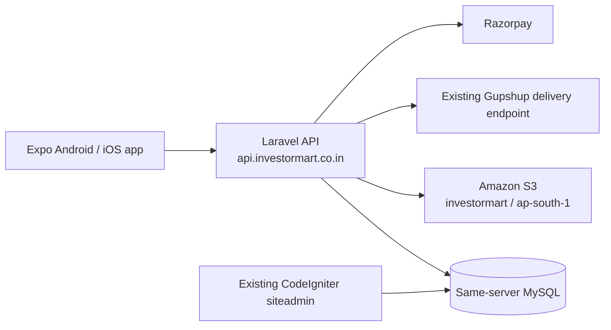

# InvestorMart implementation and handoff plan

## Target architecture



- Laravel is deployed on the existing cPanel server under `api.investormart.co.in`.
- Laravel and the CodeIgniter website use the same MySQL database over `localhost`.
- `app_users`, `property`, and `enquiry1` are authoritative legacy tables for account, listing, and lead operations.
- Additive `im_*` tables remain for mobile/API-only data: OTP hashes, bearer tokens, shortlists, plan subscriptions, Razorpay orders, capacity state, audit records, and metadata that the legacy schema cannot safely hold.

## Complete implementation flow

### 1. Identity and login

1. App requests a six-digit OTP from Laravel.
2. Laravel generates the OTP, stores only its hash in `im_otp_challenges`, applies expiry/attempt limits, and sends the code through the existing Gupshup-backed InvestorMart endpoint.
3. On verification, Laravel finds or creates the corresponding `app_users` row and links it to an `im_accounts` record for secure mobile tokens and app-specific metadata.
4. Provider type maps to the agreed mobile roles: builder, owner, or broker. Client/buyer maps to the client experience.
5. Laravel issues a Sanctum bearer token. The Expo app stores it in SecureStore.

### 2. Client catalogue and property details

1. Public APIs read approved legacy properties where `property.status = 1` and `is_delete = 0`.
2. Laravel maps legacy field names to the existing React Native property-card/detail response so the frontend UI does not change.
3. Legacy image filenames are rendered using `https://investormart.s3.ap-south-1.amazonaws.com/property_folder/property_gallary/{filename}`.
4. Guest users can browse, search, filter, and open details.
5. Shortlist is stored in `im_listing_favorites`; it requires a signed-in client.
6. Call and WhatsApp actions first create a lead event, then open `tel:` or `wa.me` on the device.

### 3. Provider listing workflow

1. Provider submits the existing app form.
2. Laravel validates it and creates a legacy `property` row with `status = 0`, linked to the provider’s `app_users.id`.
3. The existing `/siteadmin` Pending Properties screen sees the row immediately.
4. Provider uploads up to eight allowed files. Laravel creates restricted S3 upload URLs under the confirmed property gallery prefix, then stores only raw filenames in `por_baner` and `por_img_1` through `por_img_7`.
5. Existing admin approves the property in CodeIgniter by setting `property.status = 1`.
6. Laravel public APIs read the updated status from MySQL, so the property becomes visible to clients without duplicate approval logic.
7. Provider can view all of their legacy records, including pending, live, inactive, and plan-held records.

### 4. Inquiry workflow

1. A signed-in client taps Call, WhatsApp, or submits the inquiry form.
2. Laravel writes the lead to legacy `enquiry1`, linked to `property_id` or `project_id`.
3. The existing admin CRM sees the lead immediately.
4. Provider and mobile admin dashboards query the same lead source and map legacy lead status to the mobile status labels.
5. Existing email notification behaviour is either retained through the CodeIgniter route or duplicated through Laravel only after the client confirms there will be no duplicate email.

### 5. Premium plan and capacity workflow

1. Every provider receives ten free publicly live slots.
2. Razorpay creates and verifies a one-time payment through Laravel. The verified payment and entitlement are stored in `im_plan_orders` and `im_provider_subscriptions`.
3. Laravel tracks which legacy `property.pro_id` rows are eligible for a live slot using an additive mapping/state record.
4. When capacity is available and a legacy property has admin status `1`, it remains publicly visible.
5. When a premium plan expires, excess records are moved to the agreed non-public legacy state and retained in the provider workspace. A capacity state record preserves whether the reason is plan hold, pause, archive, or rejection.
6. A scheduled Laravel command runs every minute to expire plans, restore eligible plan-held records after purchase, and reconcile any direct CodeIgniter admin status changes.

### 6. Admin workflow

- Existing CodeIgniter `/siteadmin` remains the primary legacy admin panel and continues to approve/reject property records directly.
- The mobile Admin Panel reads the same legacy properties/leads, plus app-only plans and payment records.
- Mobile admin approval actions must write legacy `property.status` so the website admin and mobile admin remain synchronized.
- Every API-admin action is recorded in `im_admin_audit_logs`.

## Work sequence

### Phase A — legacy-data adapter

1. Add repositories/services that create and update `app_users`, `property`, and `enquiry1` safely.
2. Replace native listing creation/update paths with legacy-property mapping.
3. Add legacy property status mapping for pending/live/inactive and provider workspace lists.
4. Update mobile admin endpoints to list and update legacy records.
5. Keep `im_*` tables only for app-specific data and link them to legacy IDs.
6. Test mobile listing creation, CodeIgniter approval, API visibility, lead creation, and provider queries against the local imported database.

### Phase B — media and authentication integration

1. Configure legacy media prefixes and direct-S3 public URL rendering.
2. Generate restricted uploads for the confirmed S3 path without public ACL headers.
3. Configure the OTP HTTP sender in staging using rotated server-only secrets.
4. Configure the confirmed OTP expiry, cooldown, attempt, and resend limits.
5. Test OTP failure, expiry, resend, disabled user, and new-account paths.

### Phase C — plan and payment completion

1. Link slot capacity state to legacy property IDs.
2. Implement provider pause/hold/swap behaviour against the selected legacy status mapping.
3. Configure Razorpay test keys and webhook in staging.
4. Test order creation, signature verification, duplicate webhook delivery, failed payment, paid entitlement, expiry, and restoration.
5. Add the server cron job for plan-capacity reconciliation.

### Phase D — frontend integration and acceptance testing

1. Connect every existing frontend screen to live Laravel endpoints while keeping its UI unchanged.
2. Verify guest browsing, login gate, OTP, shortlist, filters, property detail, Call, WhatsApp, provider dashboard, property submission, media upload, leads, plan purchase, and mobile admin.
3. Test on Android and iOS development builds against staging.
4. Run security, error, pagination, slow-network, upload-failure, and duplicate-request checks.

### Phase E — deployment and release

1. Create the cPanel subdomain and point its document root to Laravel `public/`.
2. Install Composer dependencies and confirm PHP 8.3 or newer is available. The current Laravel backend requires PHP 8.3+.
3. Configure server `.env`, file permissions, HTTPS, cache, queue, cron, logs, and health check.
4. Take a database backup and run additive migrations in staging, then production.
5. Build Android/iOS releases with the final Expo/EAS owner and package/bundle IDs.
6. Submit after store compliance, privacy policy, account deletion, support, and payment review are complete.

## Inputs still required before staging

1. **Source files:** `Front::addproperties()`, `Front::editproperties()`, `Front::contact_us_save`, `siteadmin/property-status-toggle.php`, and the relevant `project_review` code, all without secrets.
2. **Final status mapping:** confirm which existing legacy field/value represents provider pause, archive, and plan hold. `property.status = 2` is known as inactive/expired, but it must be confirmed for every non-public state.
3. **Project scope:** confirm whether the app must display Projects in addition to individual Properties, and provide the exact project approval/public-status field.
4. **Hosting readiness:** cPanel PHP version must be 8.3+, Composer/SSH/cron availability, final `api.investormart.co.in` document root, and deployment engineer contact.
5. **Staging:** actual staging DNS/URL, `investor_staging` database, S3 staging prefix, and test client/provider/admin accounts.
6. **OTP:** rotated endpoint token configured by the deployment engineer; the static test OTP may be enabled only in staging/review and never production.
7. **Razorpay:** completed merchant KYC, test keys, test webhook secret, enabled methods, and test-payment owner.
8. **Media:** IAM role/credentials configured server-side with access limited to the required S3 prefixes.
9. **Optional services:** Firebase/FCM, APNs, Maps project/API keys, and SMTP/SES decision if those features are in release one.
10. **Release ownership:** final Expo/EAS, Google Play, Apple Developer/App Store Connect owners and the confirmed `com.investormart.app` identifiers.

## Deployment engineer checklist

```text
Create api.investormart.co.in -> /home3/gharl0dc/api/public
Install PHP 8.3+, Composer, required PHP extensions, and Laravel dependencies
Create staging database and backup production database
Configure Laravel .env only on the server
Run php artisan migrate --force
Run php artisan config:cache, route:cache, and queue/cron setup
Set cron: php artisan schedule:run every minute
Configure Gupshup OTP, S3, Razorpay test/live webhook, SMTP, and logs
Expose GET /api/v1/health through HTTPS
Provide staging URL and test accounts for acceptance testing
```
